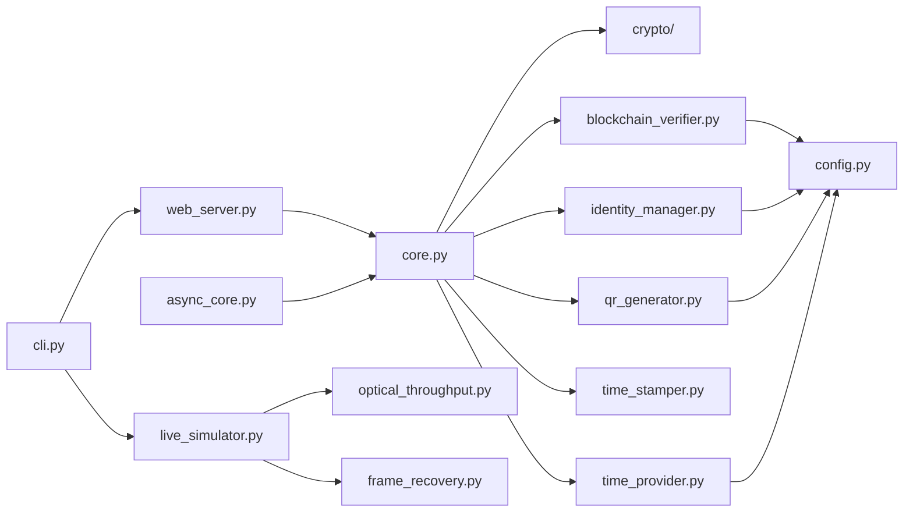

# Package map

Generated on 2026-11-12 from the `import` statements under `src/`. An arrow from A to B means code in A imports B; arrows already implied by a longer path are left out, so the picture shows layering rather than every edge. It shows 14 of the package's 18 top-level parts: the largest ones that import or are imported by others.

